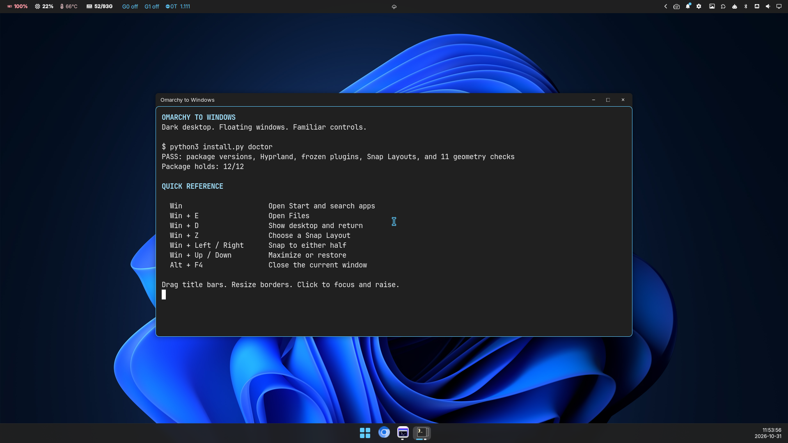
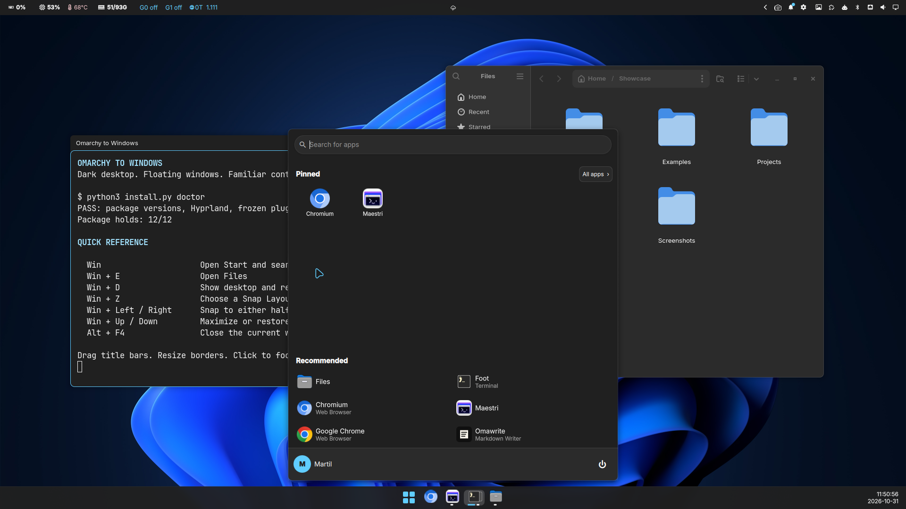
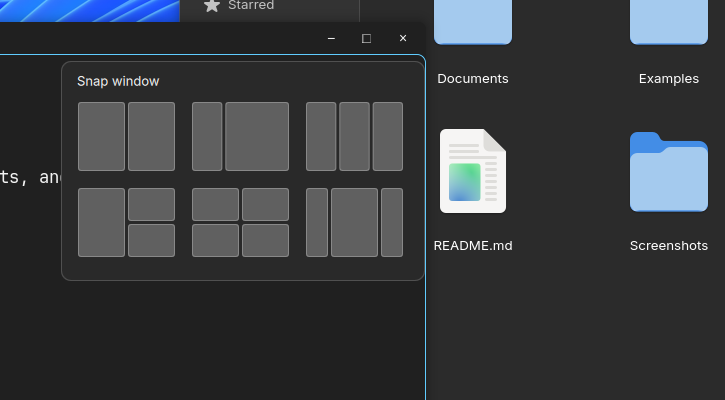
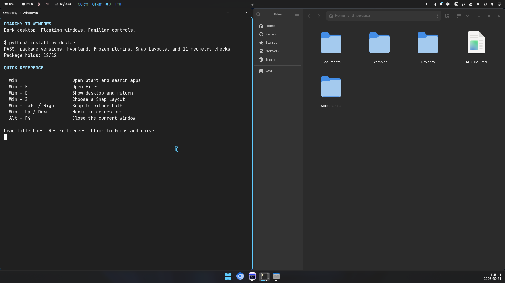

# Omarchy to Windows

A Windows 11 inspired dark desktop for Omarchy, with floating windows, a bottom taskbar, mouse controls, and Snap Layouts.



This is a desktop customization bundle. It contains an Omarchy service plugin for Snap Layouts, a modified Hyprbars plugin for Hyprland, a pinned copy of StartBar, a dark palette, and keyboard bindings. Use the installer for the complete desktop.

The screenshots are real captures from the configured desktop, using public demonstration content. Wallpaper, installed applications, pinned apps, and status widgets reflect that desktop. The installer preserves your existing wallpaper and widgets; it does not download the wallpaper shown here.

## Features

### Dark appearance and readable apps

- Graphite surfaces, light text, blue accents, rounded corners, and window shadows.
- Dark shell and GTK apps, with Inter for interface text and monospaced terminal fonts.
- A 32 px top status bar and a 48 px bottom taskbar with centered app icons.
- Fluent GTK styling when `Fluent-Windows-11` is already installed, with Adwaita-dark as the fallback.
- A palette applied through Omarchy's theme system, plus a theme hook that reapplies the dark GTK preferences when this theme is selected.

### Mouse and window controls

- Overlapping floating windows. Clicking an exposed window focuses it and raises it above other floating windows. The previous window stays open behind it.
- Activating a floating window also raises it when switching away from or back to a maximized browser.
- Newly opened Chromium-based browser windows stay floating, including when Omarchy's browser tag rules are reapplied.
- Click-based focus: moving the pointer over another window keeps the current keyboard focus.
- Dragging by the title bar and resizing from window borders, without holding `Win`.
- Minimize, maximize/restore, and close buttons on Hyprbars title bars. Double-clicking the title bar toggles maximize.
- Small pointer movements during a title-bar click stay clicks. Dragging a maximized Hyprbars window restores it with the title bar under the pointer.
- Native title bars for GNOME apps, Chromium, and Maestri, avoiding a second set of controls.
- Native Wayland maximize/restore buttons and title-bar double-clicks, including windows already open when the bundle is activated.
- Native Wayland and XWayland minimize requests forwarded to the taskbar's minimized workspace.
- Conversion of existing tiled windows during activation, including maximized and minimized windows while preserving those states.

### Start menu, taskbar, and status bar

- A Windows-style Start menu with app search, pinned apps, an app list, and session controls.
- Centered taskbar icons, app pinning, window grouping, and previews for apps with multiple windows.
- Clicking the active taskbar item minimizes an app with one window. Clicking its minimized item restores and focuses it.
- A bottom clock, with existing taskbar pins and app settings preserved.
- Taskbar settings for icon size, alignment, grouping, previews, and auto-hide.
- Existing top status widgets retained, including hardware, weather, network, audio, and tray widgets when installed.
- Start, clock, workspace, active-window, and dock widgets removed from the top bar to avoid duplicated controls.
- Task view and Notification Center shortcuts when those optional plugins are already installed.



### Snap Layouts

Hover over a Hyprbars maximize button or press `Win+Z` to open the layout picker. Hovering keeps keyboard focus in the app. The keyboard picker supports `Tab`, `Enter`, `Escape`, and dismissal by clicking outside it.



The six layouts are:

| Layout | Arrangement |
| --- | --- |
| Halves | Two equal columns |
| One third / two thirds | A narrow left column and a wide right column |
| Thirds | Three equal columns |
| Tall left / stacked right | A full-height left half and two stacked right quarters |
| Quarters | A two-by-two grid |
| Wide center | A center half with a quarter-width column on each side |

Snap geometry accounts for the top bar, bottom taskbar, borders, and native versus Hyprbars title bars. `Win+Down` can restore the saved geometry after snapping.



### Version locks and recovery

- An exact package and upstream-source lock file, checked before installation changes the desktop.
- Optional pacman holds for 12 desktop and ABI packages.
- Frozen installed plugin copies, separate from Omarchy's Git-based plugin updater.
- A locally built Hyprbars binary matched to the supported Hyprland build.
- A private backup of the previous user configuration and StartBar checkout.
- Restoration of the pre-installation configuration, with removal of package holds added by the installer.
- A `doctor` command to check versions, loaded plugins, Snap Layouts, geometry, and package holds.

## Supported desktop

The installer requires the exact package versions in [versions.lock.json](versions.lock.json) and the matching running Hyprland commit. The main packages in the tested baseline are:

| Package | Pinned version |
| --- | --- |
| Omarchy | `4.0.5-1` |
| Hyprland | `0.56.2-4` |
| Quickshell | `0.3.2.r7.g2b4501a-1` |

The lock file also records Aquamarine, Hyprutils, Hyprlang, Hyprcursor, Hyprgraphics, and the required Qt packages.

Build requirements are Git, Python 3.11 or newer, GNU C++, Make, pkg-config, and the headers supplied by the pinned Hyprland stack. Omarchy's normal runtime tools, including `hyprctl`, `gsettings`, and `pacman-conf`, must be available. Inter and Yaru-blue icons are recommended. An existing `Fluent-Windows-11` GTK theme is reused; otherwise GTK uses Adwaita-dark. Fluent is not bundled.

The installer checks compatibility before changing the desktop. It does not downgrade packages or fetch a different Hyprland build. Custom XDG directory locations are not supported.

## Installation

Run these commands from a terminal in your Omarchy desktop, as your normal user.

1. Clone the repository:

```bash
mkdir -p ~/projects/personal
cd ~/projects/personal
git clone https://github.com/flaviomartil/omarchy-to-windows.git
cd omarchy-to-windows
```

2. Install the desktop and freeze the supported package versions:

```bash
python3 install.py install --pin-packages
```

The installer invokes `sudo` for the pacman hold files. Run the installer itself as your desktop user.

It checks compatibility, builds Hyprbars locally, saves a private backup, installs frozen plugin copies, applies the palette and window controls, reloads Hyprland, and restarts the Omarchy shell. Open apps remain running. A failed activation attempts to restore the configuration from immediately before that attempt.

3. Check the running desktop:

```bash
python3 install.py doctor
```

With `--pin-packages`, the check should report `Package holds: 12/12`. Press `Win` to open Start, `Win+E` to open Files, and `Win+Z` to try the layout picker.

The backup is stored at `~/.local/state/omarchy-to-windows/backup/` with private permissions. It includes your previous StartBar checkout and user configuration. Keep this directory local. Do not add it to a repository or share it as diagnostic evidence.

To install without package holds, omit `--pin-packages`. `--no-activate` skips explicit desktop reloads and GNOME appearance changes. Hyprland may still react to changes in files it watches.

## Frozen versions and updates

`--pin-packages` creates `/etc/pacman.d/omarchy-to-windows.conf` and includes it in the `[options]` section of `/etc/pacman.conf`. It adds `IgnorePkg` holds for 12 desktop and ABI packages. Existing holds and repository settings are preserved.

The installed StartBar and Snap Layouts directories contain no `.git` checkout. Omarchy's Git-based plugin updater therefore leaves those copies alone. Their source stays in this repository, with upstream revisions recorded in the lock file. Hyprbars is built from the vendored source rather than downloaded by a plugin manager.

The repository history has been consolidated into a single commit. Use a fresh clone for checkouts based on the earlier history, preserving any local edits before replacing an older checkout.

Other system updates remain enabled. Holding these packages can block dependent upgrades and postpones fixes for the held components. Review and test a compatible desktop stack before releasing the holds:

```bash
sudo python3 install.py unpin
```

To reapply the package holds:

```bash
sudo python3 install.py pin
```

These holds prevent normal package upgrades; they are not a guarantee against explicitly replacing packages or manually editing the installed files.

## Keyboard controls

| Key | Action |
| --- | --- |
| `Win` | Start menu |
| `Win+E` | File Explorer |
| `Win+D` | Show desktop / return to previous workspace |
| `Win+Left`, `Win+Right` | Snap to either half |
| `Win+Up` | Maximize |
| `Win+Down` | Unmaximize, restore saved snap geometry, or minimize |
| `Win+M` | Minimize active window |
| `Win+Z` | Snap Layouts |
| `Alt+F4` | Close active window |
| `Win+A` | Toggle top status bar |
| `Win+L` | Lock session |
| `Ctrl+Alt+Delete` | Session menu |
| `Ctrl+Shift+Escape` | Task Manager (`btop`) |
| `Win+Shift+Arrow` | Focus a window in that direction |

`Win+Tab` and `Win+N` are assigned when the existing Exposé and Notification Center plugins are installed. This bundle does not install or freeze those optional plugins.

## Native title bars

The shared pattern in `~/.config/omarchy-to-windows/native-titlebars` controls which apps keep their native decorations. It is used by both Hyprbars and snap geometry. Add an app class to that regular expression if it already draws its own window controls, then reload Hyprland.

The maximize hover menu is attached to Hyprbars buttons. For native title bars, use `Win+Z`. Browser and editor tabs are controlled by their applications. Maestri supports selecting and reordering editor tabs; dragging one outside the application does not create a separate OS window.

Chromium's native tab selection, reordering, detaching into another window, and reattaching were checked with a temporary browser profile. Foot has no native tabs. These app-specific behaviors are separate from the desktop's window controls.

## Restore

From this checkout:

```bash
python3 install.py restore
```

This restores the files and appearance settings saved before the first installation and releases package holds added by that installation. Other package holds are left intact. It restores your previous desktop configuration, which may itself contain earlier customizations; it is not a factory reset of Omarchy.

Restoring replaces the managed files with their saved copies. Save later edits to those files separately if you want to keep them. The backup remains available after restoration. `restore --no-activate` restores files without restarting the desktop or changing live GNOME settings.

## Source and verification

The current source passed 14 bundle tests and 367 StartBar tests. The graphical checks described in [TESTING.md](TESTING.md) passed previously. Six existing upstream QML lint warnings and a missing vendored shell lint hook remain. A full reboot and another machine have not been tested.

See [THIRD_PARTY.md](THIRD_PARTY.md) for source revisions, licenses, and screenshot context. The installable theme contains color definitions. Compiled binaries, standalone wallpaper files, user profiles, user shell settings, backup data, and credentials are excluded from the published source.

Taskbar focus and preview recovery pass window and monitor snapshots through anonymous pipes, keeping private titles out of process arguments. The optional event diagnostic uses private logs and treats filenames as data. See [SECURITY_REVIEW.md](SECURITY_REVIEW.md) for the maintainer review, fixed findings and verification limits. Independent security approval remains pending.
